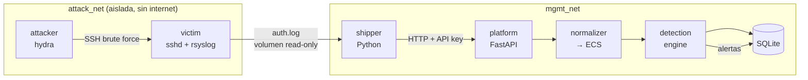

# 🛡️ mini-soc

Mini plataforma de **detección y respuesta (Blue Team)**: recibe logs, los normaliza, detecta ataques mapeados a **MITRE ATT&CK** y genera alertas. Todo se prueba contra ataques reales simulados en un laboratorio aislado y reproducible.

> Proyecto de aprendizaje construido por fases. Estado actual: **Fase 1 + rebanada vertical** (fuerza bruta SSH de punta a punta).

## Arquitectura



**Segmentación:** el atacante y la víctima viven en una red interna sin salida; la plataforma está en otra red. Un atacante que comprometa la víctima no puede alcanzar el SOC.

## Quickstart

Requisitos: Docker + Docker Compose, `make`, Python 3.

```bash
make up        # levanta lab + plataforma (genera .env con clave aleatoria)
make attack    # lanza la fuerza bruta SSH contra la víctima (solo red del lab)
make alerts    # consulta las alertas generadas
make logs      # ve las alertas en vivo en el log de la plataforma
make test      # corre los tests unitarios
make clean     # destruye todo (incluye volúmenes)
```

Resultado esperado tras `make attack`:

| Regla | Severidad | MITRE | Qué detecta |
|---|---|---|---|
| SOC-001 | high | T1110.001 Password Guessing | ≥5 fallos de SSH desde una IP en 60 s |
| SOC-002 | critical | T1078 Valid Accounts | login exitoso tras múltiples fallos (cuenta comprometida) |

## Estructura

```
lab/victim      Debian con sshd + rsyslog (deliberadamente débil, SOLO lab)
lab/attacker    Contenedor con hydra y wordlists pequeñas
lab/shipper     Agente que lee el log y lo envía a la plataforma
platform/app    API FastAPI: ingesta, normalización, detección, almacenamiento
platform/tests  Tests de parser, reglas y API
docs/           Threat model y ADRs (decisiones de arquitectura)
LEARNING.md     Diario de aprendizaje: qué hace cada pieza y por qué
```

## Roadmap

- [x] **Fase 1** Laboratorio reproducible con segmentación de red
- [x] **Vertical slice** SSH brute force: log → ingesta → detección → alerta
- [ ] **Fase 2** Más fuentes: auditd, Suricata/Zeek (tráfico de red)
- [ ] **Fase 3** Normalización completa a ECS, Postgres/OpenSearch
- [ ] **Fase 4** Reglas en formato **Sigma** + más técnicas ATT&CK
- [ ] **Fase 5** Enriquecimiento con threat intel (AbuseIPDB/OTX) y alertas a Telegram/Discord
- [ ] **Fase 6** Atomic Red Team en CI + métricas de cobertura y falsos positivos
- [ ] **Fase 7** Dashboard, documentación final y hardening de la propia plataforma

## Seguridad y ética

- Los ataques **solo** corren dentro del laboratorio aislado. El script del atacante rechaza cualquier objetivo que no sea el contenedor del lab.
- Las credenciales débiles de la víctima son intencionales y **solo** existen en la imagen del lab.
- Ver [`docs/threat-model.md`](docs/threat-model.md) para el modelo de amenazas de la propia plataforma.
